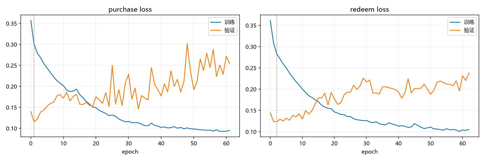
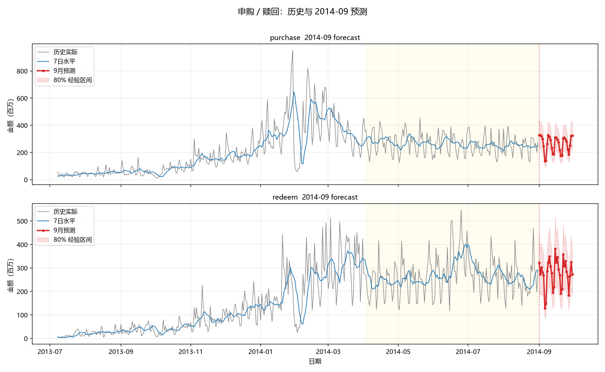

# 申购 / 赎回 LSTM 预测（2014-09）

用 2013-07-01 ~ 2014-08-31 的日频申购、赎回数据，**分别建两个 LSTM 模型**，
预测 2014-09-01 ~ 2014-09-30 每一天的申购额和赎回额，以及整月总量。

工程里同时包含：滚动回测框架、三条不依赖 LSTM 的基线、配对 bootstrap 显著性检验、
批量调参脚本。

---

## 0. 快速开始

```powershell
# 1) 建虚拟环境（Windows PowerShell）
python -m venv .venv
.\.venv\Scripts\Activate.ps1
pip install -r requirements.txt

# 2) 逐步版：从读数据到出预测，每步都打印中间结果（约 15 秒，最快看懂全流程）
python quickstart.py

# 3) 先花 10 秒确认数据长什么样
python eda.py

# 4) 完整流程：先滚动回测，再出 9 月预测（CPU 约 3~6 分钟）
python main.py --task all

# 5) 只想快点拿到 9 月预测
python main.py --task forecast

# 6) 冒烟测试：几十秒跑通整条链路，不看精度
python main.py --smoke
```

产物都在 `outputs/`：
| 文件 | 内容 |
|---|---|
| `forecast_2014-09_daily.csv` | 9 月逐日预测（预测值 / ratio / 水平 / 80% 区间 / 基线参考） |
| `forecast_2014-09_summary.csv` | 9 月月度汇总（总量、日均、峰值日、环比） |
| `submission_2014-09.csv` | **提交格式**：无表头，每行 `YYYYMMDD,申购,赎回` |
| `forecast_2014-09.png` | 历史 + 预测图 |
| `forecast_zoom_90d.png` | 最近 90 天放大图（检查周内节奏） |
| `training_curves.png` | 训练/验证损失曲线（**能直接看到过拟合点**，见 3.1） |
| `backtest_detail.csv` / `backtest_summary.csv` | 回测分折明细 / 汇总 |
| `backtest_bootstrap.csv` | 与基线的显著性检验 |
| `backtest_per_day.csv` | 回测逐日预测（可自己画图/算指标） |
| `backtest.png` | 回测期 实际 vs 模型 vs 基线 |
| `tuning/tuning_results.csv` | `tune.py` 的调参结果 |
| `run_config.json` | 本次运行的完整配置（复现用） |
| `run_log.txt` | 本次运行的完整控制台日志 |

---

## 1. 先看清数据（这一步直接决定模型怎么设计）

### 1.1 周内效应极强

`ratio = 当天值 / 过去 7 天均值`，近 90 天的周内均值：

| | 周一 | 周二 | 周三 | 周四 | 周五 | 周六 | 周日 |
|---|---|---|---|---|---|---|---|
| 申购 | **1.27** | 1.15 | 1.18 | 1.11 | 0.99 | **0.70** | 0.75 |
| 赎回 | 1.31 | 1.20 | 1.15 | 1.06 | 1.00 | 0.75 | 0.71 |

周一和周六差将近 1.8 倍，而且这个形状在整个 14 个月里都很稳定。**这是预测里最可靠的信号**，
任何模型都必须先把它学会；学不会就说明代码有问题。

### 1.2 月度水平有 ±20% 的随机波动，而且有过一次制度性跳变

- 2013-07 ~ 2013-12：申购日均 35M → 200M，一路涨。
- 2014-01 ~ 2014-02：日均升到 390~430M（单日峰值 680M），量级是 2013 年中的 10 倍以上。
- 2014-03 ~ 2014-08：回落到 250M 附近横盘。

所以：

1. **不能让 LSTM 直接预测原始值**。LSTM 无法外推出训练集之外的水平，会走平或乱涨。
2. **不能做趋势外推**。5 折回测里，把水平层从"平坦 EWMA"换成"阻尼趋势外推"，
   申购 WAPE 从 20.1% 升到 21.5%，赎回从 21.8% 升到 34.2%（`python tune.py --only base,trend_level` 可复现）。
   这份数据的月度水平是均值回复的，1 个月尺度上"延续趋势"是错的先验。
3. **不能指望日误差很低**。水平本身有 ±20% 的不可预测波动，日 WAPE 的合理下限
   大约在 15~18%；月总量误差 5~15% 是正常范围。谁给你报 3% 的日误差，八成是泄漏了。

### 1.3 9 月有个特殊点

2014 年中秋是 9 月 6-8 日（周六-周一），在预测区间内；9 月 28 日（周日）是调休上班日。
这两件事在 `src/config.py` 的 `HOLIDAYS` / `MAKEUP_WORKDAYS` 里，会变成特征喂给模型。
如果预测月跨了春节/国庆，记得把日期补进这两个列表。

---

## 2. 方法：为什么这么拆

### 2.1 三层分解

```
y_hat(t+h) = ratio_hat(h) × scale × level_hat
             └── LSTM ──┘   └─ 窗口均值 ─┘   └─ EWMA 水平 ─┘
```

| 层 | 负责什么 | 由谁算 | 为什么这么分工 |
|---|---|---|---|
| `level` | 当前"日均量级"（250M 还是 500M） | EWMA(半衰期 28 天)，整段持平 | 量级是大数、慢变、且不可预测；用一个稳健统计量就够，没必要让网络学 |
| `scale` | 当下 ratio 的常态水平 | 输入窗口内 ratio 均值 | 消除 2013 年上涨期把 ratio 均值抬高的影响（见 2.3） |
| `ratio` | 周内形状、节假日、短期动量 | **LSTM** | 这是唯一有规律、值得用网络学的部分 |

好处：LSTM 的输出被限制在 1 附近，训练稳定；水平错了也只错在水平上，不会和形状混在一起，
回测时一眼能看出是"水平估错"还是"形状学错"。

### 2.2 两个模型

申购、赎回各一个 LSTM、各一套标准化参数、各一条水平路径。默认两个模型互为输入
（申购模型能看到赎回最近的 ratio，反之亦然），因为二者共享同一批市场冲击；
想关掉就设 `use_both_targets=False`。

### 2.3 目标为什么要除以"窗口均值"

`ratio` 的长期均值在 2013 年上涨期被抬到 1.1 左右；2014 年横盘后真实值≈1.0。
模型会向训练集均值回归，导致系统性高估 10~15%（这是我在回测里实测到的最大一个坑）。

解决办法：训练目标改成 `ratio(t+h) / mean(ratio[t-L+1 .. t])`，预测时再乘回去。
这是一个**因果变换**（只用窗口内的历史），不泄漏，但把长期漂移消掉了。
回测里关掉它（`target_norm=raw`），申购 WAPE 从 20.1% 升到 26.0%，赎回从 21.8% 升到 22.9%。

### 2.4 输出头：`future` vs `multistep`

```python
head = "future"     # 默认
```

- **future（默认）**：LSTM 只编码过去 28 天，得到一个向量 `enc`；解码时对第 h 天
  拼接 `[enc, 那一天的日历特征（周几/节假日/月内位置）, h/31]`，过一个小 MLP 输出 1 个数。
  未来日历是**已知信息**，直接喂进去，等于告诉模型"你要预测的那天是周一"。
- **multistep**：经典做法，一次输出 31 个数。要求网络自己从窗口里推断"第 3 个输出对应周三"，
  在 300 个样本的规模下很难学准。

实测（5 折回测，其余配置相同）：`multistep` 头申购 21.1%、赎回 22.6%；
`future` 头申购 20.1%、赎回 21.8%。这也是为什么默认用它。

`direct` 与 `recursive`：

- `mode="direct"`（默认）：一次预测整月，无误差累积。
- `mode="recursive"`：每天预测一步、把预测值塞回窗口再滚 30 次。可以预测任意长度，
  但误差会累积，通常更差；用它主要是为了对比/教学。

### 2.5 特征清单

| 特征 | 维度 | 说明 |
|---|---|---|
| `ratio_purchase` / `ratio_redeem` | 2 | 当天值 / 过去 7 天均值（因果） |
| `lvl_purchase` / `lvl_redeem` | 2 | `log(1+水平)` 的 z-score（可关） |
| `dow_0..6` | 7 | 星期几 one-hot |
| `is_holiday` / `is_makeup` | 2 | 法定节假日 / 调休上班日 |
| `dom_sin` / `dom_cos` | 2 | 月内位置（月初/月末效应） |

未来协变量（只给 `future` 头用）：上面后 11 维（日历部分）+ `h/31`。

### 2.6 怎么防泄漏

1. 所有特征只依赖当天及以前（`level` 用 `shift(1).rolling(7)`）。
2. 训练/验证**按时间切**，并且中间空 `val_gap=31` 天，因为相邻样本的窗口重叠 27/28。
   随机切分会让验证集"看到未来"，指标虚高一大截。
3. 标准化参数只用训练段统计。
4. 回测时，预测 M 月模型只见过 M 月之前的数据；9 月预测同理。

---

## 3. 怎么判断"模型是不是更好了"

这是整个工程里最容易被糊弄的地方，所以单独讲。

### 3.1 唯一可信的裁判：滚动回测

```powershell
python main.py --task backtest
```

对 2014-04 ~ 2014-08 每个月：用该月之前的数据训练 → 预测整个月 → 和真值比。
这和"用 8 月及之前预测 9 月"**完全同构**，所以回测分数才对 9 月有参考价值。

> ❌ 不要用训练 loss 判断。训练 loss 降了、回测变差，就是过拟合，这在 400 天数据上非常常见。
> ❌ 不要用 9 月的预测结果判断——没有真值，你无法评估。
> ❌ 不要只做一次 8 月单折。单折的运气成分极大。

`outputs/training_curves.png` 就是现成的例子：



训练 loss 一路降到 0.10，验证 loss 在第 1-2 轮见底后一路升到 0.27 —— 之后学的全是噪声。
早停把权重恢复到第 1-2 轮，这个"看起来很没训练"的模型才是泛化最好的那个。

### 3.2 指标怎么选

| 指标 | 定义 | 适合看什么 | 坑 |
|---|---|---|---|
| **WAPE** ⭐ | `Σ\|误差\| / Σ\|实际值\|` | 主指标，总量视角的误差率 | 对量级不敏感，正好是我们想要的 |
| **月总量误差** ⭐ | `(预测月总 - 实际月总)/实际月总` | 业务口径，老板只关心这个 | 会掩盖日内的结构性错误 |
| MAE / RMSE | 绝对误差 | 同量级下比较 | 跨月份不可比（1 月和 8 月差 10 倍） |
| MAPE | 平均绝对百分比误差 | 参考 | 数值小的日期会放大，2013 年那段会主导结果 |
| bias% | 平均误差 / 平均值 | **看有没有系统性高估/低估** | 正负会互相抵消，必须单独看 |

**建议主看 `WAPE` + `月总量误差`，同时确认 `bias%` 接近 0。**
本工程回测表里这三列都有。

### 3.3 三步判断法

**第一步：单折看方向。** 改完参数，5 折里赢了几折？

```
各折胜负
purchase | weekday_profile | 2/5     ← 5 折只赢 2 折，大概率是噪声
```

**第二步：看均值 + 波动 + 最差折。**

```
模型            | WAPE均值% | WAPE标准差 | 最差折% | 月总量误差% | 平均偏差%
lstm_ensemble   | 18.60    | 3.48     | 22.33  | 9.73      | +8.94
mean_same_dow   | 17.86    | 2.77     | 21.14  | 8.83      | +5.26
weekday_profile | 20.29    | 4.84     | 27.82  | 11.75     | +10.75
```

LSTM 均值比 `weekday_profile` 好 1.7pp，**最差折从 27.8 降到 22.3**，稳定性提升明显。

**第三步：配对分块 bootstrap 看显著性。**

```
目标      | 对比               | WAPE差(pp) | 90%CI下 | 90%CI上 | P(LSTM更好)
purchase  | vs weekday_profile | -1.74     | -3.25  | -0.22  | 0.97    ← 显著更好
redeem    | vs weekday_profile | +0.02     | -2.01  | +1.95  | 0.48    ← 打平
```

purchase 的 CI 不跨 0、P=0.97 → 可以说"显著更好"；
redeem 差值 0.02pp、CI 跨 0、P≈0.5 → **结论只能是"打平"，不能吹成"提升"**。

为什么按周分块重采样：相邻日期的误差高度相关（周末一起低、节前一起高），
按天独立重采样会低估方差，容易得出"显著"的假结论。

### 3.4 先量一下噪声地板

同一份配置换三个随机种子，WAPE 的波动通常在 **±0.5~1.5pp**。
**小于这个幅度的"提升"一律当噪声。** 具体做法：

```powershell
python main.py --task backtest --seed 1 --ensemble 1 --no-plot
python main.py --task backtest --seed 2 --ensemble 1 --no-plot
python main.py --task backtest --seed 3 --ensemble 1 --no-plot
```

### 3.5 经验判据

| 现象 | 判断 |
|---|---|
| WAPE 降 < 1pp，且只在一两折赢 | 噪声，别改 |
| WAPE 降 1~2pp，多折一致、CI 仍跨 0 | 可能有用，保留但要继续观察 |
| WAPE 降 > 2pp，且 CI 不跨 0 | 真提升 |
| 均值变好但最差折变差很多 | 用稳定性换均值，谨慎 |
| 训练 loss 降、验证 loss 也降、但回测变差 | 过拟合回测这 5 个月，别采用 |
| bias% 从 +10% 变成 -2% | 方向修正了，通常比 WAPE 小降更有价值 |

### 3.6 残差诊断（比指标更能发现问题）

1. **bias% 是否有系统性符号**：一直正 = 水平估高了，回去查 `level_mode`。
2. **按星期几分组的残差**：如果周一总是低估、周六总是高估，说明周内形状没学对。
3. **峰值日有没有抓住**：`forecast_2014-09_summary.csv` 里的 `peak_date`。
4. **误差是否集中在某几折**：如果是，多半是水平切换月，属于不可预测部分。

---

## 4. 调参建议

### 4.1 按性价比排序（重要）

| 优先级 | 参数 | 建议范围 | 默认 | 影响 |
|---|---|---|---|---|
| ★★★ | `level_mode` | `flat` / `trend` | `flat` | **最大**，决定水平对不对 |
| ★★★ | `level_ewma_halflife` | 14 / 28 / 42 | 28 | 水平跟得快还是稳 |
| ★★★ | `target_norm` | `window_mean` / `raw` | `window_mean` | 第二重要，去掉长期漂移 |
| ★★★ | `ensemble` | 3 ~ 8 | 5 | 几乎稳赚，降方差 |
| ★★☆ | `head` | `future` / `multistep` | `future` | 结构性差异 |
| ★★☆ | `lookback` | 21 / 28 / 35 | 28 | 4 周=周期完整，太短噪声大 |
| ★★☆ | `hidden` | 32 / 48 / 64 | 48 | >64 在这份数据上只会过拟合 |
| ★★☆ | `dropout` | 0.05 / 0.1 / 0.2 | 0.1 | 和 hidden 一起调 |
| ★★☆ | `loss` | `huber` / `mse` | `huber` | 单日异常值多时 huber 更稳，实测两个目标一致更好 |
| ★☆☆ | `lr` | 1e-3 / 3e-3 / 5e-3 / 1e-2 | 5e-3 | 配合 cosine 衰减 |
| ★☆☆ | `batch_size` | 8 / 16 / 32 | 16 | 小数据下 16 左右合适 |
| ★☆☆ | `epochs` / `patience` | 200~500 / 40~80 | 400 / 60 | 有早停，epochs 给大点没关系 |
| ★☆☆ | `input_noise` | 0 / 0.01 / 0.02 | 0 | 轻微加噪有时能提 0.5~1pp |
| ★☆☆ | `sample_decay` | 1.0 / 0.999 | 1.0 | 制度切换期可试 |
| ☆☆☆ | `layers` | 1 / 2 | 1 | 2 层要配 0.2 dropout，通常无收益 |

### 4.2 用 `tune.py` 批量比

```powershell
# 粗筛：只训 1 个种子、150 轮，几分钟出结果
python tune.py --ensemble 1 --epochs 150

# 只看某几项
python tune.py --only base,lookback21,no_level_feat --ensemble 3
```

脚本会跑完整回测，按目标分组输出 WAPE 表格和 `vs_base`，明细存 `outputs/tuning/tuning_results.csv`。

**用法纪律：一次只改一个维度**，否则你不知道是谁带来的变化。

### 4.3 具体怎么调（推荐顺序）

1. **先定水平层**：`level_mode` / `halflife` 各试 2~3 个值。这一层决定上限，别急着调网络。
2. **再定集成数**：`ensemble=5` 基本是免费的收益，先固定。
3. **然后调结构**：`lookback`、`hidden`、`dropout`，每个试 2~3 个值。
4. **最后微调训练**：`lr`、`batch`、`loss`。
5. 选定后再跑 `python main.py --task all` 出最终结果。

### 4.4 不建议做的事

- ❌ 加深网络（3 层以上）、加宽到 128+：400 天数据撑不住，必然过拟合。
- ❌ 用原始值当目标：会走平或乱涨，见第 1.2 节。
- ❌ 随机切分训练/验证：指标会虚高 5~10pp。
- ❌ 在 5 折上反复挑参数几十次：这是"对回测过拟合"，最后上线会打回原形。
  挑到 2~3 轮就该停，回到结构和数据本身找改进。

---

## 5. 当前结果

以下数字由 `python main.py --task all --ensemble 5` 产出，可用 `outputs/backtest_summary.csv` 复核。

### 5.1 滚动回测（2014-04 ~ 2014-08，每折预测整月，ensemble=5，loss=huber）

**申购 purchase**

| 模型 | WAPE均值% | 标准差 | 最差折% | 月总量误差% | 平均偏差% | 技能分 |
|---|---|---|---|---|---|---|
| mean_same_dow_4w | **17.86** | 2.77 | 21.14 | 8.83 | +5.26 | +0.120 |
| **lstm_ensemble** | **18.60** | 3.48 | **22.33** | 9.73 | +8.94 | +0.083 |
| weekday_profile | 20.29 | 4.84 | 27.82 | 11.75 | +10.75 | 0（基准） |
| seasonal_naive | 23.02 | 2.27 | 27.49 | 2.22 | −0.15 | −0.134 |

**赎回 redeem**

| 模型 | WAPE均值% | 标准差 | 最差折% | 月总量误差% | 平均偏差% | 技能分 |
|---|---|---|---|---|---|---|
| **lstm_ensemble** | **21.14** | 5.05 | 30.23 | **9.98** | **+0.83** | +0.005 |
| weekday_profile | 21.24 | 3.74 | 28.51 | 12.24 | +4.83 | 0（基准） |
| mean_same_dow_4w | 24.59 | 5.75 | 32.99 | 16.40 | +7.04 | −0.158 |
| seasonal_naive | 26.33 | 1.97 | 30.22 | 6.95 | +0.91 | −0.240 |

**显著性检验（配对分块 bootstrap，按周分块）**

| 目标 | 对比 | WAPE差(pp) | 90% CI | P(LSTM 更好) | 结论 |
|---|---|---|---|---|---|
| purchase | vs seasonal_naive | −4.35 | [−7.08, −1.74] | 1.00 | **显著更好** |
| purchase | vs weekday_profile | −1.74 | [−3.25, −0.22] | 0.97 | **显著更好** |
| purchase | vs mean_same_dow_4w | +0.77 | [−0.76, +2.23] | 0.20 | 略差，不显著 |
| redeem | vs seasonal_naive | −4.95 | [−9.23, −0.74] | 0.97 | **显著更好** |
| redeem | vs mean_same_dow_4w | −3.13 | [−6.38, −0.16] | 0.96 | **显著更好** |
| redeem | vs weekday_profile | +0.02 | [−2.01, +1.95] | 0.48 | 打平 |

**逐折胜负**：purchase 对 weekday_profile **5/5** 全胜，对 seasonal_naive 4/5；
redeem 对 seasonal_naive 4/5、对 weekday_profile 2/5。

### 5.2 2014-09 预测

| 目标 | 预测月总量 | 基线月总量 | 8月实际 | 环比 | 日均 | 峰值日 | 低谷日 |
|---|---|---|---|---|---|---|---|
| 申购 | **78.58 亿** | 77.52 亿 | 79.21 亿 | −0.8% | 2.62 亿 | 09-02（3.28 亿） | 09-06（1.36 亿） |
| 赎回 | **82.86 亿** | 81.77 亿 | 77.71 亿 | +6.6% | 2.76 亿 | 09-15（3.82 亿） | 09-06（1.29 亿） |

关键日（完整 30 天见 `outputs/forecast_2014-09_daily.csv`）：

| 日期 | 星期 | 申购 | 赎回 | ratio（申购） | 说明 |
|---|---|---|---|---|---|
| 09-01 | 一 | 3.26 亿 | 3.22 亿 | 1.283 | 正常周一 |
| 09-05 | 五 | 2.45 亿 | 2.69 亿 | 0.964 | 周五回落 |
| **09-06** | 六 | **1.36 亿** | **1.29 亿** | **0.535** | 中秋假期，比普通周六还低 |
| 09-07 | 日 | 1.39 亿 | 1.48 亿 | 0.547 | 中秋假期 |
| **09-08** | 一 | **2.64 亿** | 2.86 亿 | **1.038** | 中秋（周一），远低于普通周一的 1.2~1.28 |
| 09-09 | 二 | 3.27 亿 | 3.22 亿 | 1.287 | 节后回补 |
| **09-28** | 日 | **2.50 亿** | 2.66 亿 | **0.985** | 调休上班日，明显高于普通周日的 0.74 |

这张表是模型"学到了东西"最直接的证据：**中秋（9/6~9/8）的塌陷**和
**9/28 调休上班的抬升**都被捕捉到了，而 `weekday_profile` 基线在 9/8 会直接按
普通周一给到 3.22 亿（高估约 20%）。



### 5.3 怎么看这组结果

- **申购**：显著优于"周内形状×水平"基线（5/5 折全胜，CI 不跨 0），但略逊于
  `mean_same_dow_4w`（17.86% vs 18.60%）——这条基线用"最近 4 周同一星期几"直接估，
  相当于给了每个星期几各自一个近期水平，对水平漂移更敏感。差距 0.7pp，在噪声范围内。
- **赎回**：WAPE 与基线打平，但**月总量误差 9.98% vs 12.24%、偏差 +0.83% vs +4.83%**
  都更好。业务上更看重总量和方向，这个结果比"WAPE 打平"更有意义。
- **整体水平**：日 WAPE 19~21%，月总量误差 10% 左右。这是这份数据在当前特征下的合理水平。
- **9 月**：申购环比 −0.8%（8 月已从 7 月低点小幅回升，基本走平），赎回环比 +6.6%。
  注意 9 月比 8 月少一天（30 vs 31 天），所以"日均"其实都是小幅上行的。

---

## 6. 局限与下一步

**数据层面**

1. 只有 14 个月，**学不到年度季节性**（9 月只有一个历史样本），所以 9 月的预测本质是
   "近期水平 × 周内形状 + 节假日修正"，不含"9 月通常比 8 月高多少"这种信息。
   想学年度季节性，至少需要 3 年数据。
2. 缺外部变量。申购/赎回大概率受货币基金收益率、同类产品规模、大盘行情、IPO 打新、
   节假日安排影响。把这些做成日频特征加进来，是最可能带来实质提升的方向。
3. 2014-01/02 的制度性跳变目前只能靠 `sample_decay` 弱化，没有做变点检测。

**方法层面**

1. `out_len=31` 意味着**最后 31 天不能作为训练锚点**（需要完整的 31 天目标）。
   对 9 月预测来说，8 月的样本进不了训练。改进：加 mask 的损失函数，
   让末尾样本只用前几天的目标参与训练。
2. 可以给预测加**分位数损失**（pinball loss），输出 P10/P50/P90，比现在的经验区间更严谨。
3. 可以试 **TFT / N-BEATS / DeepAR**，但先解决数据量问题，否则换模型收益有限。
4. 模型融合：`0.5 × LSTM + 0.5 × weekday_profile` 通常能同时降低均值误差和最差折，
   值得在回测里试一下（当前没做）。

**工程层面**

1. 现在每次回测都重新训练，没有缓存。折数多时建议把训练好的模型按 (fold, seed) 缓存。
2. 生产化要加：数据校验（缺失/异常值/口径变更）、预测结果的合理性检查
   （比如月总量环比超过 ±50% 要告警）、以及模型版本管理。

---

## 7. 常见问题

**Q：一定要 GPU 吗？**
不用。这份数据 CPU 训练 1 个模型只要几秒，`--task all` 几分钟。代码里
`torch.set_num_threads(2)` 是为了避免小模型的多线程调度开销。

**Q：图里的中文变方框了？**
`src/utils.py` 会自动找系统里的中文字体（微软雅黑/黑体/苹方等）。都找不到时会自动
回退成英文标签。也可以手动改 `setup_matplotlib` 里的 `candidates`。

**Q：每次都跑出不一样的结果？**
固定了 `seed`，同一配置应该可复现。若仍抖动，检查是否改了 `--ensemble` 或线程数
（`torch` 的 CPU 归约顺序会影响最后几位小数）。集成本身就是用来压这种抖动的。

**Q：为什么 LSTM 没有大幅超过"星期几均值 × 水平"这种简单基线？**
因为在这份数据里"周内形状"占了绝大部分可解释方差，而简单基线正好把这部分估得很准；
剩下的是水平随机波动（不可预测）和少量结构（节假日/调休）。当前 LSTM 的增量主要来自
后者：它把 9/8 的中秋、9/28 的调休上班单独学了出来，这些是固定周内因子做不到的。
想在 WAPE 上再明显提升，得靠**外部变量**（收益率、规模、大盘），而不是换更大的网络。

**Q：训练日志里"最佳 epoch 1~2"是不是模型没训好？**
不是 bug。样本只有 260 条、日历特征又直接给了最强信号，模型 1-2 轮就学完了主要规律，
再训下去只是记住 2013 年的噪声（训练 loss 继续降、验证 loss 上升）。
早停选在 epoch 1-2 正是它该做的事。**判断模型好坏看回测，不要看 epoch 数或训练 loss。**

**Q：预测值明显不合理怎么办？**
先看 `forecast_2014-09_summary.csv` 里的 `baseline_total`（周内形状×水平）。
如果 LSTM 和它差超过 20%，多半是 ratio 预测跑偏了，检查：
① `target_norm` 是否开着；② 训练集末尾是否发生过水平跳变；③ 集成数是否太小。

---

## 8. 文件说明

```
daily_series.csv          原始数据（report_date, purchase, redeem）
quickstart.py             逐步版：读数据→特征→窗口→训练→预测，每步打印（约 15 秒）
main.py                   主入口：回测 + 预测
tune.py                   批量调参（跑完整回测并按 WAPE 排序）
eda.py                    数据探索（出 3 张图 + 控制台统计）
MODEL_EXPLANATION.md      模型解释文档（架构/参数/损失函数/5折/基线/结果）
requirements.txt
.vscode/launch.json       6 个调试配置（F5 直接跑各种任务）
.gitignore
outputs/                  所有产物（csv / png / 日志 / 配置）
src/
  config.py               所有超参数 + 节假日表 + 结构相关的长度推导
  data_prep.py            读取/清洗、水平与 ratio、日历特征、窗口、水平外推、回测折
  model.py                LSTM（multistep / future 两种输出头）
  train.py                训练循环、早停、集成推理
  pipeline.py             训练→预测的组装（direct / recursive）
  baselines.py            三条基线：季节朴素、上周同日、周内形状×水平
  metrics.py              WAPE/MAPE/sMAPE/月总量误差、配对分块 bootstrap、表格输出
  forecast.py             9 月预测 + 落盘 + 画图
  backtest.py             滚动回测 + 三张对比表
  plots.py                所有图
  utils.py                种子、目录、日志、中文字体、JSON
```

### 想改代码时注意

- 改**特征**：动 `data_prep.FeatureBuilder`，并确保 `calendar_rows_for` 的未来日历列顺序一致。
- 改**模型结构**：动 `model.py`，`forward` 的签名要和 `train.train_one`、`pipeline` 对齐。
- 改**目标定义**：动 `prepare()` 里的 `rel_ratio` 和 `pipeline` 里的反变换，两处必须成对修改。
- 新增**基线**：在 `baselines.py` 加函数，并注册到 `all_baselines()`，回测/表格会自动带上。
